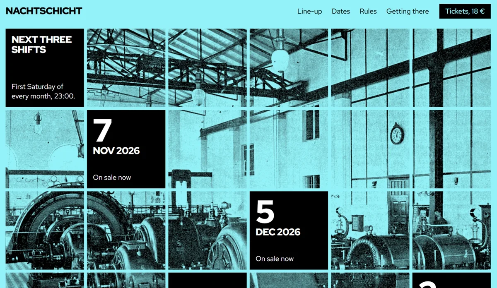
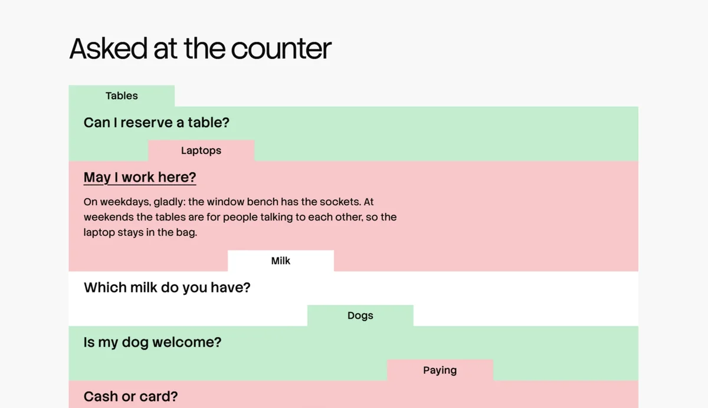

<p align="center">
  <picture>
    <source media="(prefers-color-scheme: dark)" srcset="assets/taste-skill-wordmark-dark.png" />
    
  </picture>
</p>

<p align="center">
  <a href="https://github.com/afif25fradana/taste-skill/actions/workflows/check-skills.yml"></a>
  &nbsp;
  <a href="LICENSE"></a>
  &nbsp;
  <a href="CHANGELOG.md"></a>
</p>

# Taste Skill

**Taste Skill** is an experimental Google Antigravity skill for building craft company websites. It provides curated typography pairings, harmonic palettes, a starter foundation, and an automated headless Chrome quality gate that checks rendered pages for layout overflow and contrast before delivery.

Adapted for Google Antigravity on Windows 11 from [Leonxlnx/taste-skill](https://github.com/Leonxlnx/taste-skill) under the [MIT License](LICENSE).

> [!NOTE]
> Within the `everyday-agy` workflow fleet, `taste-skill` was retired in ADR-0002 in favor of the upstream `impeccable` skill suite. This repository is maintained as an independent, standalone reference and CLI gate. Requires Node.js 22+ (Active/Maintenance LTS).

Pages built from a single brief in earlier v2 runs:

<table>
  <tr>
    <td width="50%"></td>
    <td width="50%"></td>
  </tr>
  <tr>
    <td width="50%"></td>
    <td width="50%"></td>
  </tr>
</table>

Photographs are sourced from open archives and credited by the skill ([credits](examples/v2/CREDITS.md)).

---

## Installation (Windows 11 / PowerShell)

### Prerequisites

- **Google Antigravity CLI** (`agy`) on `PATH`
- **Node.js 22+**
- **Google Chrome, Microsoft Edge, or Chromium** (set `CHROME_PATH` if using a non-standard browser install location)
- **ffmpeg** on `PATH` (optional; used for WebP conversions and photo crops in `photos.mjs`)

### Primary Installation

Run the PowerShell installer from the repository root:

```powershell
powershell -ExecutionPolicy Bypass -File .\Install-AntigravityPlugin.ps1
```

The installer verifies SKILL frontmatter and license attribution, runs `agy plugin validate --strict`, and copies plugin files directly into `~/.gemini/config/plugins/taste-skill` as a physical directory.

> **Physical directory copy:** NTFS junctions and symlinks across drive roots fail Google Antigravity Language Server path confinement (`isGlobalPluginDir`). The installer uses `robocopy /mir` to create a physical copy rather than an NTFS link.

### Live Development Synchronization

To mirror ongoing edits into the active plugin directory during local development without a full reinstall:

```powershell
powershell -ExecutionPolicy Bypass -File .\Install-AntigravityPlugin.ps1 -Sync
```

Other installer options:

```powershell
# Overwrite an existing installation
powershell -ExecutionPolicy Bypass -File .\Install-AntigravityPlugin.ps1 -Force

# Remove the plugin directory and unregister the plugin
powershell -ExecutionPolicy Bypass -File .\Install-AntigravityPlugin.ps1 -Uninstall
```

---

## Workflow

Invoke `/taste-skill` in Google Antigravity chat, or execute the underlying scripts directly using Node 22+.

### Deal Palettes and Typography

Deal a harmonic palette and Google Fonts pairing for a given page kind and trade:

```powershell
node skills/taste-skill/scripts/start.mjs deal --page <kind> --trade <trade>
```

- **Kinds**: `software`, `gaming`, `tech`, `product`, `service`, `place`.
- **Trades**: `cafe`, `bakery`, `restaurant`, `hotel`, `wellness`, `studio`, `workshop`, `law`, `clinic`, `agency`, `saas`, `devtool`, `fintech`, `ai`, `game`, `hardware`, `consumer-product`.

Generate the corresponding stylesheet links and `:root` design token block:

```powershell
node skills/taste-skill/scripts/start.mjs css --page <kind> --palette <id> --type <id>
```

### Starter Template Usage

Copy the starter foundation from `skills/taste-skill/assets/` into your project (`starter.html`, `system.css`, and `layout/`):
- Enforces one section per screen at desktop viewports (`100svh`).
- Sets equal left and right margins with a fixed navigation header.
- Provides accessible color tokens and responsive typography scales.

### Browser Quality Gate

Before handing off the completed page, run the automated finish gate to verify layout stability, responsive scaling, copy hygiene, and contrast in headless Chrome:

```powershell
# Arm the finish gate for a build
node skills/taste-skill/scripts/gate.mjs --start index.html --kind <kind>

# Run browser finish checks
node skills/taste-skill/scripts/gate.mjs index.html --kind <kind>
```

The finish gate reports `GATE: PASS` when all checks succeed, or `GATE: FAIL` with diagnostics if visual defects or placeholder copy remain.

---

## Verification & Testing

This repository uses Node.js built-in test runners and the Antigravity CLI directly (`package.json` does not include an `npm test` script).

Run the test suite from the repository root:

```powershell
node --test tests/win-compat.mjs
node tests/text-encoding.mjs
node tests/frontmatter.mjs
agy plugin validate --strict .
```

*Note: `node tests/frontmatter.mjs` requires the `yaml` package (`npm install --no-save --no-package-lock yaml@2.6.1`).*
