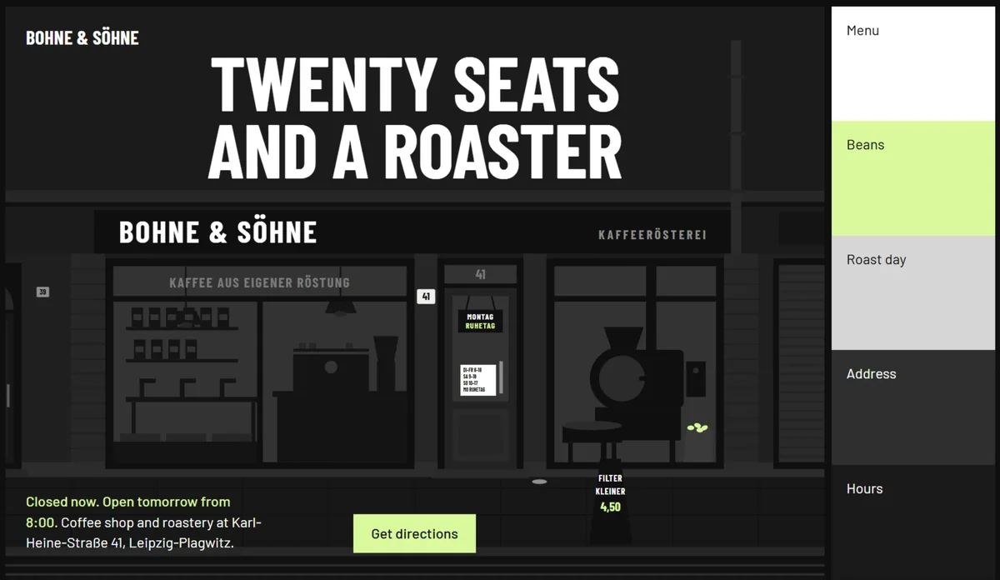
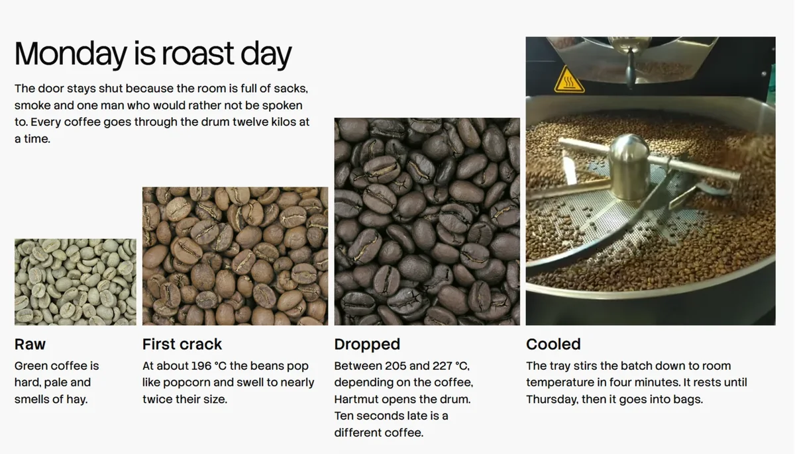

<p align="center">
  <picture>
    <source media="(prefers-color-scheme: dark)" srcset="assets/taste-skill-wordmark-dark.png" />
    
  </picture>
</p>

<p align="center">
  <a href="LICENSE"></a>
  &nbsp;
  <a href="CHANGELOG.md"></a>
</p>

**Taste Skill** (`tasteskill 2.5.1`) is a Google Antigravity plugin for building company websites. It enforces plain copy, one section per screen, equal left and right edges, real photographs or product UI, and restrained motion, then verifies built pages in a real browser before handoff.

Adapted for Google Antigravity on Windows 11 from [Leonxlnx/taste-skill](https://github.com/Leonxlnx/taste-skill) (`v2.5.1`) under the [MIT License](LICENSE).

Pages built from a single brief in earlier v2 runs:

<table>
  <tr>
    <td width="50%"></td>
    <td width="50%"></td>
  </tr>
  <tr>
    <td width="50%"></td>
    <td width="50%"></td>
  </tr>
</table>

Photographs are sourced from open archives and credited by the skill ([credits](examples/v2/CREDITS.md)). Watch the [launch film](https://github.com/Leonxlnx/taste-skill/releases/tag/v2.0.0).

## Install (Antigravity / Windows 11)

Requires **Node 22+** and **Chrome, Edge, or Chromium** (set `CHROME_PATH` if installed in a non-standard location). **ffmpeg** on `PATH` is optional for WebP conversion and phone hero crops in `photos.mjs`. The skill installs no npm dependencies and needs no API keys; bundled Wikimedia Commons photographs work offline, while fetching extra photographs, Google Fonts, or brand icons uses network access.

Install from a local clone in PowerShell:

```powershell
.\Install-AntigravityPlugin.ps1
```

[`Install-AntigravityPlugin.ps1`](Install-AntigravityPlugin.ps1) checks root [`LICENSE`](LICENSE) and [`skills/taste-skill/SKILL.md`](skills/taste-skill/SKILL.md) (UTF-8 without BOM, within the 24,000-byte body limit), prunes any legacy `$HOME\.agents\skills\design-taste-frontend` directory or junction, runs `agy plugin validate --strict`, installs the plugin, and verifies the entry with `agy plugin list --json`.

- Link from the clone with `.\Install-AntigravityPlugin.ps1 -Link` to create an NTFS junction at `$HOME\.gemini\config\plugins\taste-skill` so `git pull` updates the plugin in place.
- Remove the installed plugin (or junction) and any legacy `$HOME\.agents\skills\design-taste-frontend` folder with `.\Install-AntigravityPlugin.ps1 -Uninstall`.

Or run the Antigravity CLI commands manually from the repository root:

```powershell
agy plugin validate --strict .
agy plugin install .
agy plugin list
```

> **Skill name note:** Upstream `Leonxlnx/taste-skill` registers `design-taste-frontend`. This Antigravity plugin sets `name: taste-skill` in [`skills/taste-skill/SKILL.md`](skills/taste-skill/SKILL.md) to expose `/taste-skill` in chat.

## Usage & Architecture

Invoke `/taste-skill` in Antigravity chat (served from `skills/taste-skill/`).

### `ui-crafter` Dual-Mode

When paired with `ui-crafter`, [`skills/taste-skill/SKILL.md`](skills/taste-skill/SKILL.md) selects one of two modes:

- **Codebase Component Mode** applies to full pages, static HTML, and framework builds. It enforces all nine house rules, the `100svh` one-section-per-screen box rule (`skills/taste-skill/assets/starter.html` or the project's framework shell), and Step 6 browser checks.
- **Generative UI Widget Mode** applies to compact `<agent-embed>` widgets (`< 500px`). It follows host `generative_ui/SKILL.md` tokens and skips the `100svh` section-box rule and Step 6 browser gate while keeping plain copy.

### Windows 11 Tooling & Browser Verification

- [`skills/taste-skill/scripts/win-util.mjs`](skills/taste-skill/scripts/win-util.mjs) locates `chrome.exe` or `msedge.exe` (`CHROME_PATH`, `CHROME`, `LOCALAPPDATA`, `Program Files`, and `Program Files (x86)`), strips UTF-8 BOMs in `readJson`, confines file operations inside the project (`isInside`), and terminates headless browser process trees on Windows with `taskkill` (`killTree`).
- `scripts/consistency.mjs` and `scripts/gate.mjs` run directly from the CLI as a manual finish gate. In PowerShell, wrap `--category`, `--primary`, and `--done` values containing spaces in double quotes (`"..."`).
- Step 6 verification in [`skills/taste-skill/SKILL.md`](skills/taste-skill/SKILL.md) uses Chrome DevTools MCP (`chrome-devtools`, `a11y-debugging`, `debug-optimize-lcp`, `evaluate_script` for `AUDIT` and `window.lyCheck()`, and `take_screenshot` for `share.jpg`). `scripts/perf.mjs` and `scripts/shoot.mjs` remain in `skills/taste-skill/scripts/` as CLI fallbacks.

## How 2.5 works

Ask your agent to build or redesign a company site; the agent loads the skill, copies `skills/taste-skill/assets/` into the project, starts from `assets/starter.html`, and runs the checker before handing the page over. All `scripts/`, `assets/`, and `library/` paths below live inside `skills/taste-skill/`. Every build starts by classifying the client's business (`software`, `gaming`, `tech`, `product`, `service`, or `place`) and planning the page screen by screen before writing markup:

1. **Deal tokens and layout.** `scripts/start.mjs` deals a palette for the trade and a Google Fonts pairing for the page kind (`library/palettes.json`, `library/type.json`). `assets/layout/deal.mjs` deals a hero layout (`split`, `centred`, `product`, `photo`, `place`, `collage`, `editorial`, `word`, `film`, `statement`, or `triptych`).
2. **Start from one system.** `assets/starter.html`, `assets/system.css`, and `assets/layout/layout.css` enforce one section per screen at desktop (`1440x900`), equal left and right content edges, a fixed navigation bar, and a single-screen closing footer (`footer.closing`).
3. **Show real product UI and real photographs.** Software and tech pages populate lit feature cards (`assets/ui/cards.css`) with rewritten HTML UI fragments (`assets/ui/`) and node-and-line diagrams (`assets/diagrams/`); `scripts/icons.mjs` resolves brand and interface SVGs locally. Place, shop, hospitality, and non-technical product pages lead with curated photographs (`scripts/photos.mjs`, `assets/photos/`), typography, and flat colour. Sources are credited in one expandable footer line with no image captions.
4. **Keep effects for tech and gaming pages.** Shader grounds (`scripts/effects.mjs`), scroll scenes (`assets/scenes/`), and procedural 3D prints (`assets/objects/`) are dealt only on `software`, `tech`, and `gaming` pages within a four-context WebGL cap, with static fallbacks for phones and reduced motion. Every page gets a hero entrance and one or two moments from `scripts/moments.mjs`; cafes, hotels, shops, studios, and services get only the photo- and type-led ones, with zero WebGL.
5. **Check in a real browser over HTTP.** `scripts/consistency.mjs`, `assets/layout/check.mjs`, and Chrome DevTools MCP (with `scripts/perf.mjs` and `scripts/shoot.mjs` as CLI fallbacks) inspect the built page across `1440`, `1024`, `768`, and `390`. They check for empty visuals, broken shaders, contrast drops, misaligned columns, section-height drift, placeholder text, invented street numbers, and slow-network image gaps. `scripts/gate.mjs` holds completion until no fixable FAIL remains, up to three rounds.

## The tools

Every tool is a plain Node 22+ script in `skills/taste-skill/`; none installs third-party packages.

| Tool | What it does |
| --- | --- |
| `scripts/start.mjs` | Deals a palette and a Google Fonts pairing for the page kind and prints the `<head>` links and `:root` tokens. |
| `assets/layout/deal.mjs` | Deals one of eleven tested hero layouts; `assets/layout/check.mjs` checks it with long-headline stress tests. |
| `scripts/photos.mjs` | Deals vetted photographs by trade, enforces image weight, and writes the single footer credit line. |
| `scripts/icons.mjs` | Resolves real brand and interface icons into local SVG files. |
| `scripts/effects.mjs`, `scripts/moments.mjs` | Deal shader grounds for tech, gaming, and software pages, and moments for every kind. |
| `scripts/gate.mjs`, `scripts/copy-lint.mjs` | Runs the manual finish gate and the copy linter. |
| `scripts/consistency.mjs` | Renders the page in headless Chrome over HTTP at `1440`, `1024`, `820`, `768`, and `390` and prints PASS, WARN, or FAIL per rule. |
| `scripts/perf.mjs`, `scripts/shoot.mjs` | CLI fallbacks behind Chrome DevTools MCP for page weight/speed measurements and full-page or per-section screenshots. |

Run from the project folder to deal tokens and arm the finish gate:

```powershell
node path/to/skills/taste-skill/scripts/start.mjs deal --page software
```

Kinds: `software`, `gaming`, `tech`, `product`, `service`, `place`. Check a built page with:

```powershell
node path/to/skills/taste-skill/scripts/consistency.mjs <url-or-file> --page <kind>
```

## Common Questions

**Where do the pictures come from, and can I use them?**  
From the skill's photograph library (`skills/taste-skill/assets/photos/photos.json`, including bundled Wikimedia Commons WebP sets and Unsplash photographs) dealt by `scripts/photos.mjs`. Library frames depict trade and material details or are used as explicit draft stand-ins when the client has no photographs yet. They are never presented as the client's own room, staff, or product, and are credited in one expandable footer line (`photos.mjs credits`).

**Does it work with React, Vue, Svelte, plain HTML?**  
An empty folder gets a static page from `skills/taste-skill/assets/starter.html`. Existing React, Vue, Svelte, Astro, or Tailwind projects are built in their own stack with the kit served from their public folder; Next.js briefs are built as static exports. Browser checks run against the served or built page.

**When does a page get shaders or scroll effects?**  
Shaders run only on `software`, `tech` (technical hardware), and `gaming` pages within a four-context WebGL budget, with static fallbacks for phones and reduced motion. Places, shops, cafes, hotels, studios, services, and physical products use photographs, typography, and flat colour with a hero entrance and one or two photo- or type-led moments.

## Origin & License

Originated from [Leonxlnx/taste-skill](https://github.com/Leonxlnx/taste-skill) (`v2.5.1`). See [CHANGELOG.md](CHANGELOG.md) for upstream history from `2.1.x` through `2.5.1`.

[MIT License](LICENSE) · Copyright (c) 2026 Leonxlnx, Afif Fradana
